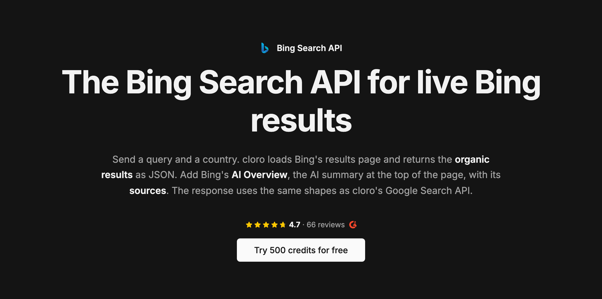

# Bing Search Scraper

[](https://cloro.dev/bing-search-api/?utm_source=github)

[](https://cloro.dev/)

The [Bing Search scraper](https://cloro.dev/bing-search-api/?utm_source=github) by cloro is an API that returns the live Bing results page as parsed JSON: the organic results and, on request, the AI Overview, which is Bing's AI summary at the top of the page, with its sources.

In short, cloro's Bing Search API:

- loads a new Bing results page for each request, so the results are not from a cached index;
- returns `organicResults` and `aioverview` in the same shapes as cloro's [Google Search scraper](https://github.com/cloro-dev/google-search-scraper), so one parser reads both engines;
- sets the Bing market from `country`, for all countries except China, South Korea and Russia;
- returns a URL to the raw HTML of the page beside the parsed JSON, at no extra credit cost (`include.html`);
- has an official [Python SDK](https://github.com/cloro-dev/cloro-python) and an official [Node SDK](https://github.com/cloro-dev/cloro-node);
- runs its own proxies and automatic retries, so you solve no CAPTCHAs, and bills only successful requests.

## How do you scrape Bing Search?

1. Get an API key at [cloro.dev](https://cloro.dev/?utm_source=github&utm_medium=readme).
2. POST a query and a country to `https://api.cloro.dev/v1/monitor/bing`.
3. Read the parsed fields from the JSON response.

### Request sample (Python)

```python
# pip install cloro
from cloro import Cloro

client = Cloro(api_key='YOUR_API_KEY')

response = client.monitor.bing(
    query='how to remove rust from cast iron',
    country='US',
    include={'aioverview': {'markdown': True}},
)

for result in response['result']['organicResults']:
    print(result['position'], result['link'], result['title'])
```

### Request sample (cURL)

```bash
curl -X POST https://api.cloro.dev/v1/monitor/bing \
  -H "Authorization: Bearer YOUR_API_KEY" \
  -H "Content-Type: application/json" \
  -d '{"query": "how to remove rust from cast iron", "country": "US", "include": {"aioverview": true}}'
```

Node.js and async/webhook examples are in the [endpoint documentation](https://cloro.dev/docs/api-reference/endpoint/monitor-bing).

### Request parameters

| Parameter | Description | Default |
| --- | --- | --- |
| `query`\* | The search query. Up to 3,500 characters after URL encoding, fewer for non-Latin scripts | – |
| `country`\* | Country code (`US`, `GB`, `DE`). Sets the Bing market. All countries except `CN`, `KR` and `RU` | – |
| `include.aioverview` | `true` returns the AI Overview. `{"markdown": true}` also returns it as Markdown | – |
| `include.html` | Return a URL to the full HTML of the page that Bing rendered (expires after 24h) | `false` |

\* Required

The endpoint has no `state`, `location`, `device` or `pages` parameter. Each call returns the first results page.

## What data does the Bing Search scraper return?

```json
{
  "success": true,
  "result": {
    "organicResults": [
      {
        "position": 1,
        "title": "How to Clean a Rusty Cast-Iron Skillet - Martha Stewart",
        "link": "https://www.marthastewart.com/how-to-clean-rusty-cast-iron-skillet-8408007",
        "displayedLink": "https://www.marthastewart.com",
        "snippet": "To remove rust, scrub the skillet with steel wool, soak it in a vinegar solution, and re-season it afterward...",
        "page": 1
      }
    ],
    "aioverview": {
      "text": "Rust can be safely removed from cast iron using abrasives, vinegar, or salt, followed by thorough drying and re-seasoning...",
      "sources": [
        {
          "label": "How to Remove Rust from a Cast Iron Skillet: 11 Steps",
          "url": "https://www.wikihow.com/Remove-Rust-from-a-Cast-Iron-Skillet",
          "description": null,
          "position": 2
        }
      ],
      "citationPills": [
        {
          "label": "How to Remove Rust from a Cast Iron Skillet: 11 Steps",
          "citationPillId": 1,
          "url": "https://www.wikihow.com/Remove-Rust-from-a-Cast-Iron-Skillet",
          "domain": "wikihow.com",
          "position": 2
        }
      ]
    },
    "html": ["https://cdn.cloro.dev/results/5d0f3c8e-2b7a-4c1e-9f64-8a3e1b7d2c90/page-1.html"]
  }
}
```

1. **`organicResults`**: position, title, link, displayed link, snippet, page and, when Bing shows one, date. `link` is the destination URL, not Bing's click-tracking URL.
2. **`aioverview`**: Bing's AI summary with its text, its sources and one citation pill per chip and source pair. With `{"markdown": true}` it also has `markdown`. It is present only when you set `include.aioverview` and Bing shows a summary.
3. **`html`**: an array with one URL to the page that Bing rendered, when you set `include.html`.

Full field-level schemas are in the [endpoint reference](https://cloro.dev/docs/api-reference/endpoint/monitor-bing).

## Use cases

- **Bing rank tracking** by market: Bing ranks pages differently in each country, so run the same queries per `country` on a schedule ([guide](https://cloro.dev/blog/bing-rank-tracking/)).
- **AI Overview monitoring on Bing**: whether Bing shows a summary for a query, and which pages it cites.
- **Bing and Google side by side**: the same field names on both engines, on one API key.
- **Migration from the retired Bing Search API**: a replacement for the web results part of Bing Search API v7.

## FAQ

### Does this replace the retired Bing Search API?

It replaces the part that returned Bing web results. Microsoft retired Bing Search API v7 on August 11, 2025. cloro takes a query and a country and returns the organic results from the Bing results page. The field names are cloro's, not the v7 names, so a migration needs a small field mapping ([Bing Search API key guide](https://cloro.dev/blog/bing-search-api-key/)).

### How is Bing Search different from Bing AI Mode?

Bing Search (`POST /v1/monitor/bing`) returns the normal results page at `bing.com/search` for a `query`. Bing AI Mode (`POST /v1/monitor/bing/aimode`) returns the answer on Copilot Search in Bing for a `prompt`. They are separate endpoints, and the [Microsoft Copilot scraper](https://github.com/cloro-dev/microsoft-copilot-scraper) covers Bing AI Mode.

### What does a request cost?

3 credits on the async API, the same as Google Search. The AI Overview adds 2 credits, and cloro charges it also when Bing shows no summary. A sync request adds 2 credits ([pricing](https://cloro.dev/docs/guides/providers#provider-list-and-base-costs)). `include.html` costs nothing.

### Does it return ads, news or image results?

No. The response has the organic results of the first results page, the AI Overview and the HTML URL.

### Which SDK methods call this endpoint?

In Python, `client.monitor.bing(query=..., country=..., include=...)` from [`cloro`](https://pypi.org/project/cloro/) 0.5.0 or later. In Node, `client.monitor.bing({ query, country, include })` from [`@cloro-dev/cloro`](https://www.npmjs.com/package/@cloro-dev/cloro) 0.5.0 or later.

### How do I run a large query set on a schedule?

Send each query as `payload` with `taskType: "BING"` to `POST /v1/async/task`, or up to 500 at a time to `POST /v1/async/task/batch`. Collect the results by webhook or by polling ([async requests](https://cloro.dev/docs/guides/making-requests/async)). Async tasks have no sync surcharge.

### Do I need my own proxies, and who handles CAPTCHAs?

You need no proxies, and you solve no CAPTCHAs. cloro sends each request through its own proxy in the `country` you set and retries a failed attempt automatically, up to 5 attempts ([retries](https://cloro.dev/docs/guides/error-handling#retries-and-cancellation)). Errors and failed tasks cost nothing ([billing](https://cloro.dev/docs/guides/billing)).

### Is scraping Bing results legal?

cloro returns publicly visible results pages. No court has ruled that scraping public results is unlawful, though the area is active. Check your own jurisdiction and use case.

## Learn more

- **Endpoint reference:** [cloro.dev/docs](https://cloro.dev/docs/api-reference/endpoint/monitor-bing)
- **Product page:** [cloro.dev/bing-search-api](https://cloro.dev/bing-search-api/)

## Other cloro scrapers

[AI Mode](https://cloro.dev/ai-mode/) · [AI Overview](https://cloro.dev/ai-overview/) · [Bing AI Mode](https://cloro.dev/bing-ai-mode/) · [ChatGPT](https://cloro.dev/chatgpt/) · [Gemini](https://cloro.dev/gemini/) · [Google Search](https://cloro.dev/google-search/) · [Google News](https://cloro.dev/google-news/)

## Contact us

Questions or support: [ask the docs AI assistant](https://cloro.dev/docs/?assistant).
